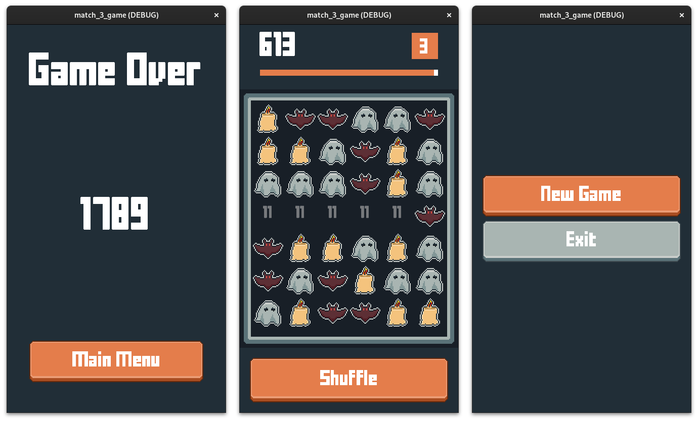

# Match3 (cykgames 004)



A Halloween-themed **match-3 puzzle** for Android (portrait, touch-first),
built with **Godot 4.7.2** (`gl_compatibility`). Based on the MIT-licensed
[luiz734/match3_game](https://github.com/luiz734/match3_game).

**Status: mvp** — playable, headless-verified, APK built; pending on-device
verification.

## How to play

- **Drag a piece onto an adjacent piece** to swap them (touch or mouse).
  A swap only sticks if it makes a match of 3+; otherwise it swaps back.
- Match 3 / 4 / 5 / T-shapes score points; cascades build combos.
- The top bar shows your **score**, the **level** counter, and a level-up
  progress bar that drains over time — keep matching to stay alive.
- **Shuffle** rearranges the board but costs one level.
- **Restart** starts a fresh run; **Menu** returns to the title screen.
  Escape / Android back also navigate back.
- If the level counter drops below zero, it's game over.

## Controls

| Input | Action |
|---|---|
| Drag piece → adjacent piece | Swap (touch / mouse) |
| Shuffle button | Shuffle board (costs 1 level) |
| Restart button | New run |
| Menu button | Back to title |
| Escape / Android back | Back / quit from title |

## Build

Requires Godot 4.7.2 (console binary) with Android export templates + SDK.

```sh
godot --headless --path . --import
godot --headless --path . --export-debug "Android" build/match3.apk
```

Package `com.cykagent.match3`, arm64-v8a only, portrait.

## Verify (headless)

```sh
godot --headless --path . res://tools/test_core.tscn   # 12 core unit tests
godot --headless --path . res://tools/autoplay.tscn    # 65s autoplay bot
```

## Credits

See [CREDITS.md](CREDITS.md). Base game MIT © 2023 luiz734; art/audio
author-owned; Terminal Grotesque font SIL OFL 1.1 (`assets/fonts/OFL.txt`).
The non-redistributable fff-forward font was removed.
